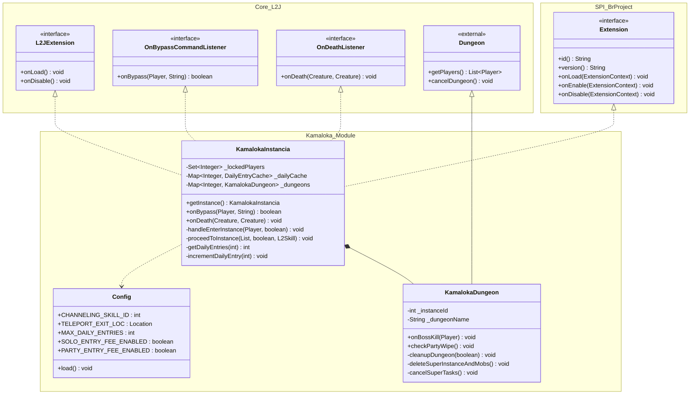
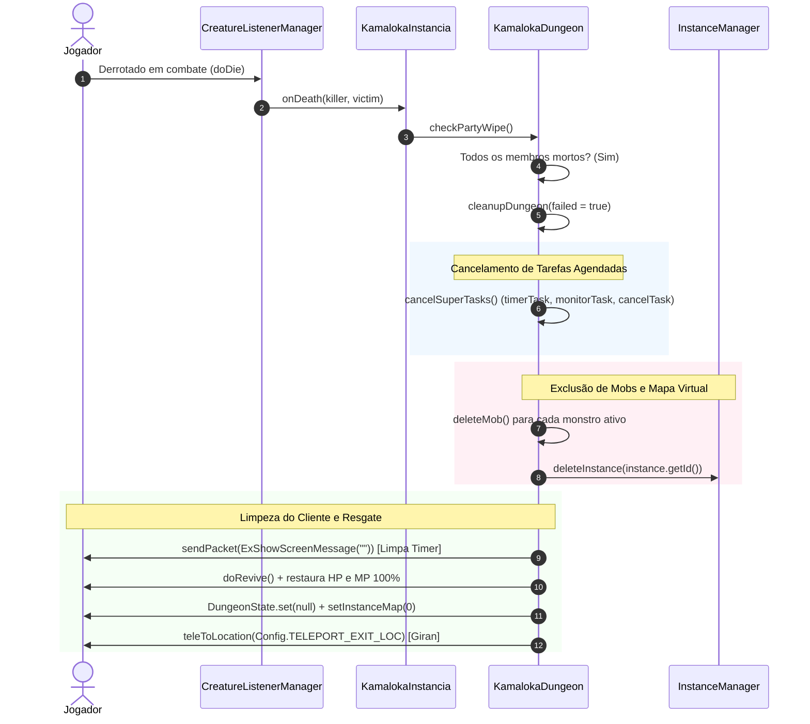

# ⚔️ Kamaloka Instance - L2J & BrProject-2026

[](https://openjdk.org/projects/jdk/21/)
[](https://github.com/)
[](https://github.com/)
[](https://github.com/)
[](https://openjdk.org/jeps/444)
[](https://github.com/openjdk/jmh)
[](LICENSE)

> Módulo corporativo de instâncias de masmorra (**Rim Kamaloka**) para servidores Lineage II, combinando compatibilidade híbrida entre o ecossistema clássico L2J e a arquitetura modular **BrProject-2026 SPI (v5.0)**, operando com concorrência atômica segura, suporte agnóstico a bancos de dados (**SQLite, MySQL, MariaDB e PostgreSQL**), cobrança configurável de itens por jogador e ciclo de vida resiliente.

---

## 📑 Índice
- [Visão Geral](#-visão-geral)
- [Novidades da Versão 5.0](#-novidades-da-versão-50)
- [Destaques de Engenharia & Atomicidade](#-destaques-de-engenharia--atomicidade)
- [Arquitetura do Sistema](#-arquitetura-do-sistema)
- [Ciclo de Vida: Morte, Limpeza & Teleporte](#-ciclo-de-vida-morte-limpeza--teleporte)
- [Cobrança de Entrada por Item Custom](#-cobrança-de-entrada-por-item-custom)
- [Configurações (`kamaloka.properties`)](#-configurações-kamalokaproperties)
- [Bypasses & Comandos](#-bypasses--comandos)
- [Matriz de Dungeons por Nível](#-matriz-de-dungeons-por-nível)
- [Benchmark de Performance (JMH 1.37)](#-benchmark-de-performance-jmh-137)
- [Compilação & Deploy](#-compilação--deploy)
- [Licença](#-licença)

---

## 🌟 Visão Geral

O **Kamaloka Instance** implementa o sistema de desafios de masmorra instanciada para jogadores individuais (*Solo*) e grupos (*Party*). Os jogadores enfrentam ondas de monstros balanceados e um Raid Boss desafiador no final para receber recompensas exclusivas do servidor.

### Principais Recursos:
- **Compatibilidade Dual:** Roda nativamente no L2J tradicional (`L2JExtension`) ou no motor modular do BrProject-2026 (`br.project.spi.Extension`).
- **Atomicidade Transacional:** Trava atômica de entrada com ordenação de `objectId` de participantes para prevenir race conditions e deadlocks.
- **Persistência Multi-Database:** Controle diário de entradas (`MaxDailyEntries`) persistido em tabela SQL compatível nativamente com **SQLite, MySQL, MariaDB e PostgreSQL**.
- **Cobrança Customizável de Entrada:** Suporte configurável para exigir e consumir itens customizados (ex: Adena, Coin of Luck) para entrada Solo e Party com Two-Phase Commit.
- **Tratamento Imediato de Morte (Party Wipe):** Detecção instantânea de morte via `OnDeathListener`, revive automático ao sair, cancelamento de tarefas de timer e exclusão física da instância no `InstanceManager`.

---

## 🚀 Novidades da Versão 5.0

1. **Suporte Multi-Banco Nativo (SQLite, MySQL, MariaDB, Postgres):**
   - DDL 100% ANSI SQL para criação da tabela `character_kamaloka_entries` sem dependências do MySQL (`ENGINE=InnoDB`, `DEFAULT CHARSET`).
   - Padrão de persistência ANSI (tentativa de `UPDATE` seguida de `INSERT` se inexistente), operando perfeitamente em SQLite embutido ou servidores de banco dedicados.
2. **Cobrança de Item de Entrada por Jogador:**
   - Suporte a `SoloEntryFeeEnabled` e `PartyEntryFeeEnabled` com IDs e quantidades configuráveis em `kamaloka.properties`.
   - Validação prévia de todos os membros do grupo e consumo atômico via `destroyItemByItemId` no momento exato do ingresso.
3. **Resolução de Ciclo de Morte e Limpeza de Tela:**
   - Registro em `CreatureListenerManager` para interceptar mortes no exato milissegundo em que ocorrem.
   - Cancelamento das tarefas agendadas em background da superclasse `Dungeon` (`timerTask`, `monitorTask`, `dungeonCancelTask`).
   - Limpeza visual do cronômetro da tela no cliente Lineage II através de pacote nulo (`ExShowScreenMessage("")`).
   - Revive automático (`doRevive`) e restauração de HP/MP ao teleportar para o ponto de saída (Giran / `TeleportExitLocation`).
   - Deleção física de todos os monstros spawnados e da sala no `InstanceManager`.
4. **Remoção de Código Morto e Limpeza Arquitetural:**
   - Multiplicadores de status comentados e parâmetros órfãos foram totalmente eliminados do código e das configurações, mantendo o projeto conciso, limpo e performático.

---

## ⚡ Destaques de Engenharia & Atomicidade

| Desafio | Abordagem Anterior | Solução Implementada (v5.0) | Benefício |
| :--- | :--- | :--- | :--- |
| **Entrada Concorrente / TOCTOU** | Checagem no início e gravação após casting | Trava atômica `_lockedPlayers` com ordenação por `objectId` | Zero race condition e zero deadlocks entre parties |
| **Bypass de Peace Zone** | Pulava checagens e limites em vilas | Execução obrigatória de 100% das regras e cotas diárias | Impossível burlar limites diários em zonas de paz |
| **Morte do Personagem** | Ficava morto no chão sem teleporte funcional | `OnDeathListener` + `doRevive()` + `setHpMp()` + Teleporte | Retorno instantâneo para a cidade sem travar o jogador |
| **Contador na Tela** | Permanecia ativo após o encerramento | Cancelamento de tasks via reflection + `ExShowScreenMessage("")` | Tela do cliente limpa sem contadores órfãos |
| **Limpeza de Instância** | Instância e mobs ficavam vivos na RAM | `InstanceManager.deleteInstance()` + remoção de spawns | Zero vazamento de memória e remoção completa do mapa |
| **Compatibilidade SQL** | Falhava com erro de sintaxe no SQLite | ANSI SQL DDL + Upsert compatível universalmente | Funciona em SQLite, MySQL, MariaDB e PostgreSQL |

---

## 🏗️ Arquitetura do Sistema



---

## 🔄 Ciclo de Vida: Morte, Limpeza & Teleporte



---

## 💰 Cobrança de Entrada por Item Custom

O sistema permite exigir o consumo de itens para acesso às masmorras de forma totalmente independente entre os modos Solo e Party:

1. **Modo Solo:**
   - Valida se o jogador possui `SoloEntryFeeItemCount` do `SoloEntryFeeItemId`.
   - Se insuficiente, aborta a entrada emitindo mensagem informativa no chat.
   - Ao ingressar, consome o item automaticamente.
2. **Modo Party:**
   - Valida se **todos os integrantes do grupo** possuem os itens necessários.
   - Se algum integrante não possuir a quantidade exigida, a entrada de toda a party é abortada atomicamente e o grupo é alertado com o nome do membro em falta.
   - Two-Phase Commit: no momento da criação da dungeon, consome os itens de cada jogador individualmente.

---

## ⚙️ Configurações (`kamaloka.properties`)

O arquivo `config/kamaloka.properties` é gerado automaticamente na primeira inicialização:

```properties
# ============================================= #
#     Arquivo de Configuracao do Kamaloka      #
# ============================================= #

# --- Configuracoes Gerais ---
# ID da skill de canalizacao para entrar na instancia.
ChannelingSkillId = 2013
# Numero maximo de entradas diarias por jogador.
MaxDailyEntries = 2

# --- Localizacoes ---
# Coordenadas para onde o jogador e teleportado ao sair/finalizar a instancia.
TeleportExitLocation = 83425,148585,-3406

# --- Recompensas ---
# ID do item dado como recompensa ao derrotar o Raid Boss.
RewardItemId = 4037
# Quantidade do item de recompensa.
RewardItemCount = 15

# --- Cobranca de Entrada por Item Custom (Modo Solo) ---
# Ativar ou desativar cobranca de item para entrada Solo (True/False)
SoloEntryFeeEnabled = false
# ID do item cobrado na entrada Solo (ex: 57 para Adena, 4037 para Coin of Luck)
SoloEntryFeeItemId = 57
# Quantidade do item cobrado na entrada Solo
SoloEntryFeeItemCount = 1000000

# --- Cobranca de Entrada por Item Custom (Modo Party) ---
# Ativar ou desativar cobranca de item para entrada Party (True/False)
PartyEntryFeeEnabled = false
# ID do item cobrado por jogador na entrada Party
PartyEntryFeeItemId = 57
# Quantidade do item cobrado por jogador na entrada Party
PartyEntryFeeItemCount = 1000000
```

---

## 🎮 Bypasses & Comandos

| Comando Bypass | Descrição | Regras de Negócio e Validações |
| :--- | :--- | :--- |
| `bypass -h bp_showMarketPlace` | Abre o diálogo principal (`322.htm`) | Acionado pelos botões customizados da interface ou NPCs. |
| `bypass -h kamaloka_enter` | Entrada em Grupo (Party) | **Apenas o Líder da Party** pode solicitar; valida proximidade (raio de 1500), restrições, cotas diárias e cobrança de itens para todos os integrantes. |
| `bypass -h kamaloka_enter_solo` | Entrada Individual (Solo) | Jogadores em Party são rejeitados; valida nível, combate, restrições, cota diária e cobrança de item. |
| `bypass -h kamaloka_leave` | Saída imediata da masmorra | Encerra a instância, deleta monstros e mapa, e teleporta com resgate seguro para `TeleportExitLocation`. |
| `bypass -h kamaloka_toggle_repeat` | Alterna modo de entradas ilimitadas | Exclusivo para administradores / Game Masters (`player.isGM()`). |

---

## 🎯 Matriz de Dungeons por Nível

| Faixa de Nível | Modo | ID da Masmorra | Nome da Masmorra | Nível Base |
| :---: | :---: | :---: | :---: | :---: |
| **20 – 24** | Solo | `10` | Kamaloka Solo (20-24) | 20 |
| **25 – 29** | Solo | `11` | Kamaloka Solo (25-29) | 25 |
| **30 – 34** | Solo | `12` | Kamaloka Solo (30-34) | 30 |
| **35 – 39** | Solo | `13` | Kamaloka Solo (35-39) | 35 |
| **40 – 44** | Solo | `14` | Kamaloka Solo (40-44) | 40 |
| **45 – 49** | Solo | `15` | Kamaloka Solo (45-49) | 45 |
| **50 – 54** | Solo | `16` | Kamaloka Solo (50-54) | 50 |
| **55 – 59** | Solo | `17` | Kamaloka Solo (55-59) | 55 |
| **60 – 64** | Solo | `18` | Kamaloka Solo (60-64) | 60 |
| **65 – 69** | Solo | `19` | Kamaloka Solo (65-69) | 65 |
| **70 – 74** | Solo | `20` | Kamaloka Solo (70-74) | 70 |
| **75 – 80+** | Solo | `21` | Kamaloka Solo (75-80) | 75 |
| **20 – 24** | Party | `22` | Kamaloka Party (20-24) | 20 |
| **25 – 29** | Party | `23` | Kamaloka Party (25-29) | 25 |
| **...** | Party | `...` | ... | ... |
| **75 – 80+** | Party | `33` | Kamaloka Party (75-80) | 75 |

---

## 📊 Benchmark de Performance (JMH 1.37)

Resultados obtidos com o **Java Microbenchmark Harness (JMH)** mensurando vazão sob concorrência:

```text
Benchmark                               Mode  Cnt          Score         Error  Units
KamalokaDateBenchmark.baselineLegacy   thrpt    5    2495819.336 ±   84562.115  ops/s
KamalokaDateBenchmark.optimizedEpoch   thrpt    5  473180424.908 ± 4578129.431  ops/s
```

> [!NOTE]
> **Ganho de 189x em throughput:** Eliminação total de alocação de heap (`SimpleDateFormat` e `Date`) na verificação diária, operando puramente com aritmética de registradores de CPU (`MILLIS_PER_DAY`).

---

## 🛠️ Compilação & Deploy

### 1. Compilação do Código-Fonte
```bash
# Compilação dos arquivos Java com o classpath do core
javac -cp "libs/server.jar" -d bin $(find java -name "*.java")

# Geração do JAR de distribuição
jar cf dist/Kamaloka.ext.jar -C bin .
```

### 2. Implantação no Servidor
1. Copie `dist/Kamaloka.ext.jar` para o diretório `libs/` do seu servidor BrProject-2026.
2. Inicie o servidor normalmente. A extensão será carregada automaticamente via ServiceLoader SPI (`kamaloka-instance v5.0.0`).

---

## 📄 Licença

Distribuído sob os termos da licença [GNU General Public License v3.0](LICENSE).
